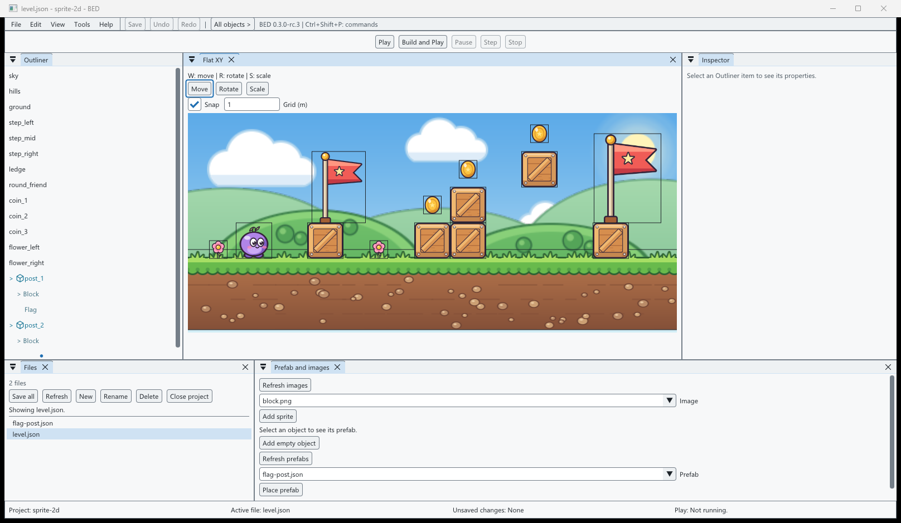
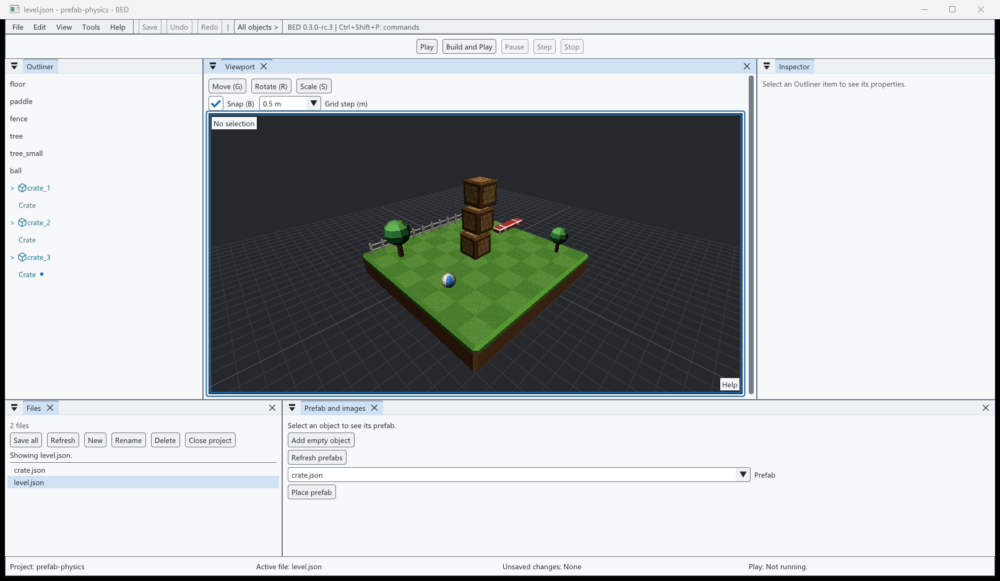
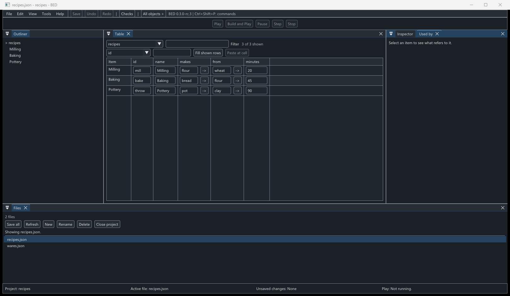
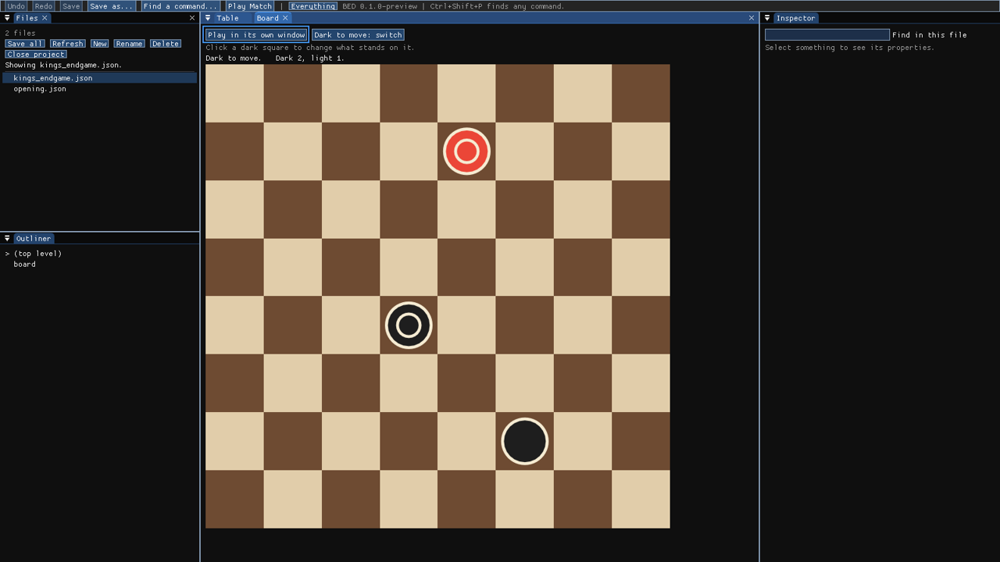
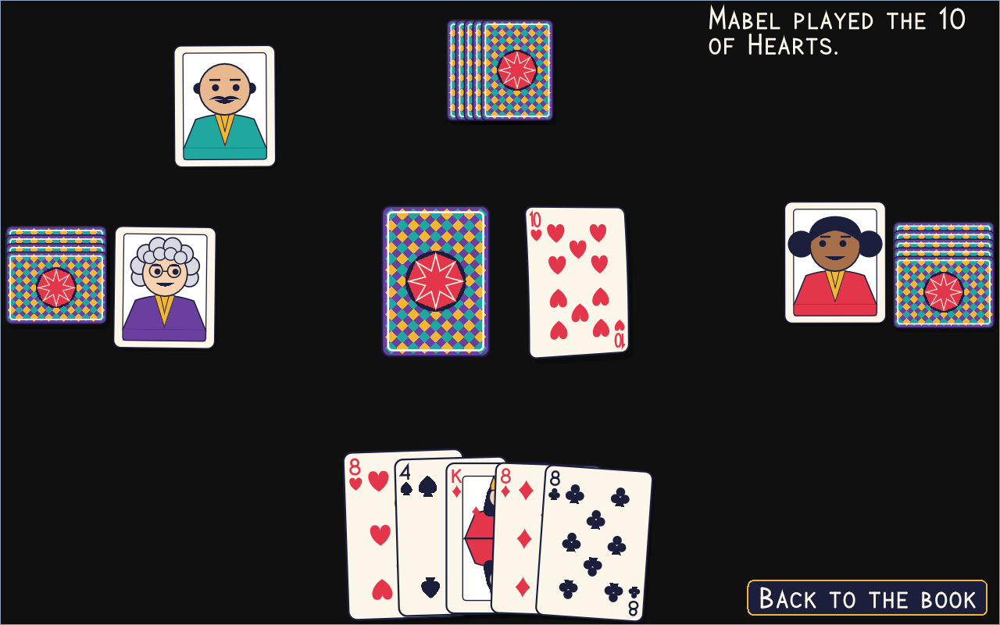
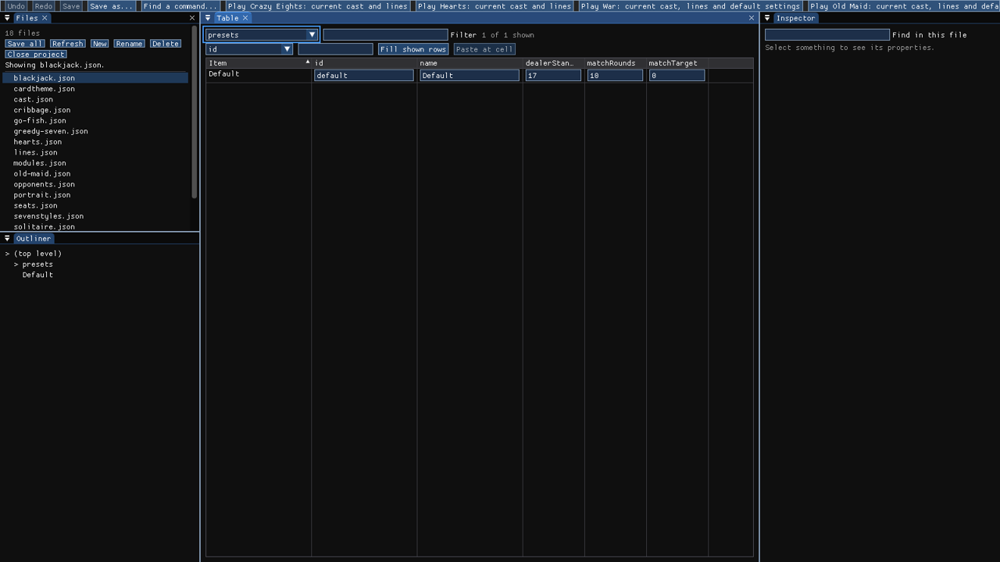
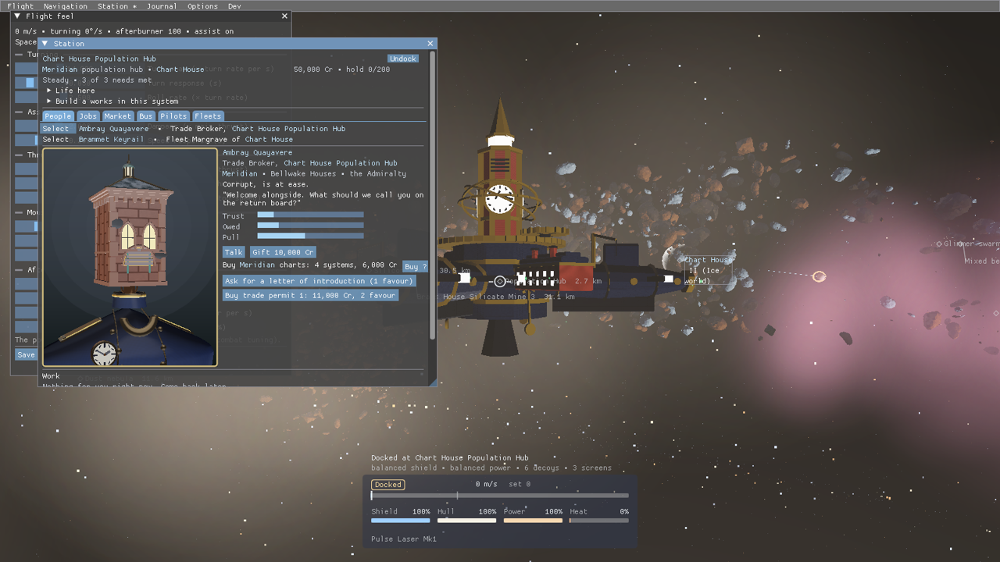
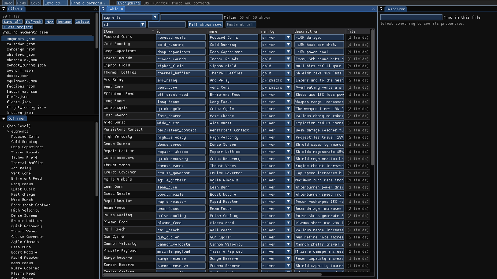
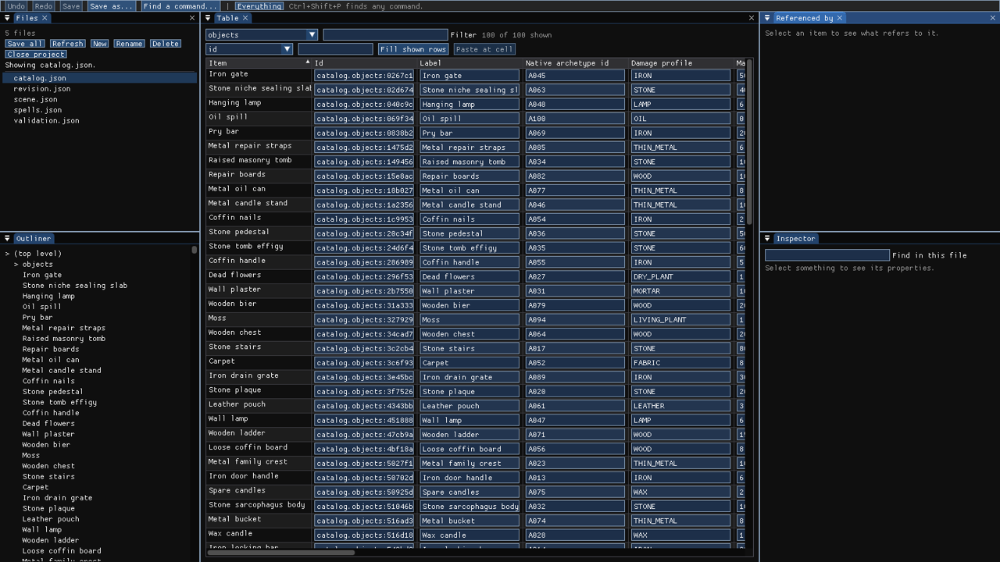

# BED: a game editor for BRUTAL games

BED edits a game's data and its 2D and 3D levels (prefabs, sprites, physics), checks every change, plays the game and exports a copy, by hand or with an AI assistant.

It's made for games written in C# on the [BRUTAL framework](https://github.com/ahwootech/BRUTAL), but the data editor works on any folder of JSON files. New to BED? Begin with **[Start here](docs/guide/start_here.md)**: ten minutes, no programming.



## What's new in 0.3

- **Prefabs.** Make a reusable piece, place it many times, and change one copy without touching the others.
- **2D levels with sprites.** Lay out pictures on a flat level, with size, pivot and drawing order.
- **Physics.** Give objects bodies with mass, friction and a shape, and set the level's gravity.
- **Two samples to try:** a cartoon garden in 2D and a 3D island with a stack of crates that have physics.
- **Plain words.** The editor says "prefab copy" and "changed in this copy" instead of programming terms, and the Outliner marks prefab copies with a colour, a box icon and a dot on changed parts.
- **Sharper text** in Windows' own interface font, at every size.
- **Engine-style layout and camera:** Outliner on the left, Inspector on the right, Play in the middle of the toolbar.
- **A first-run tour** you can skip and reopen later from **Help > Take the tour**.
- **Help > Report a problem** shows exactly what a report contains before you share it.

The current download is **0.3.0-rc.3**, a release candidate for 0.3. Get it from the [Releases page](../../releases); [CHANGELOG.md](CHANGELOG.md) lists every change and fix.

## Try it (Windows, 2 minutes)

1. Download **BED-win-x64.zip** from the [Releases page](../../releases).
2. Unzip it anywhere and double-click **BED.exe**. BED needs the Microsoft Visual C++ Redistributable (x64). If it is missing, install it from [Microsoft](https://aka.ms/vs/17/release/vc_redist.x64.exe), then open BED again.
3. Click **Try the example**. The first time, BED offers a short guided tour. Take it, or skip it.
4. Click a cell in the table, type a new value and press Enter.
5. Now type **-5** in the "minutes" column. BED refuses it and shows why next to the field.
6. Press **Ctrl+Z** to undo and **Ctrl+S** to save.

### Try the samples

Choose **File > Open project...** and open a folder from the download's **samples** folder:

- **samples\sprite-2d** is a cartoon garden in 2D: seventeen pictures in four layers, with a flag placed twice as a prefab. Drag things around, then revert the copy whose size was changed.
- **samples\prefab-physics** is a small 3D island with a stack of three crates, one prefab placed three times. Click a crate to see its body, mass and friction.

Choose **Tools > Build and Play** to run either one. These sample games have no window yet; they report what they did as text in **Play console**. [Start here](docs/guide/start_here.md#5-try-the-2d-and-physics-samples) walks through both.

The download includes a level sample too: **samples\scene-starter**, a 3D level to add models to, move them, play it and export a copy. [Edit a level](docs/guide/levels.md) has the step-by-step, and the zip's small checkers game shows an adapter at work. If you [build from source](#build-from-source), the same samples are in the `samples` folder.

The [guide index](docs/guide/README.md) covers everyday editing, levels, [Play](docs/guide/playing.md), [Export](docs/guide/exporting.md), [troubleshooting](docs/guide/troubleshooting.md) and [working with an AI assistant](docs/guide/using_bed_with_ai.md).

## Use it on your own data

On the start screen, under **Open a project**, choose:

- **Data folder:** your JSON files.
- **Rules folder:** one rules file ([JSON Schema](https://json-schema.org/)) per data file. `wares.json` is checked by `wares.schema.json`.

Then click **Open**. If a file breaks its rules, BED still opens it and helps you fix it one edit at a time. It won't save over a file that another program changed after you opened it.

## What it does

- **Levels in 3D and 2D.** Add models or sprites, move, rotate and resize them, group them, and undo anything. The camera works like other game editors.
- **Prefabs.** Place a reusable piece many times, change one copy, and choose whether to take updates to the original.
- **Physics.** Static, dynamic or moved-by-the-game bodies, with box, sphere, capsule or fitted shapes. The game simulates them when it runs; BED never changes your level while it runs.
- **Assets.** Browse models, preview textures and play sounds, and see why a model can't be placed.
- **Tables and forms** for your data, with errors shown next to the field.
- **Links between files.** Click a name to jump to the item it refers to, and see everything that refers to an item.
- **Play and Export.** Run the game from your saved files, pause it and step it if the game supports it, and export a copy that runs without BED.
- **Your game's own rules.** A small C# adapter adds checks, panels or a playable preview. See [Writing an adapter](docs/guide/writing_an_adapter.md).
- **A command line** (`bed-cli.exe`) that makes the same checked edits, for scripts, AI assistants and screen readers.
- **Keyboard and accessibility.** Text follows Windows' text size, with larger sizes and high contrast in Preferences. See the [keyboard guide](docs/guide/keyboard.md) and [accessibility](docs/guide/accessibility.md).

## What BED looks like

| | |
|---|---|
|  |  |
| A 3D level with prefabs and physics. | A data table in the dark theme. |
|  | |
| A board game's adapter: edit the board by clicking. | |

## Made with BED

I'm using BED on three or four games of my own at the moment, each a different kind of game with its own adapter. They're why BED exists, and they keep shaping what it needs to do next.

| | |
|---|---|
|  |  |
| A card game's table. | BED on the card game's settings, with a Play button for each game. |
|  |  |
| A space sim, docked at a station. | BED on the space sim's ship augments. |
|  | |
| BED on another game's catalogue of objects. | |

## Roadmap

0.2 added 3D levels, assets, Play and Windows builds. 0.3 adds prefabs, 2D levels with sprites and physics. Next, 0.4 works with the running game. See [the roadmap](ROADMAP.md) for what's done and what's left.

## Build from source

You need Windows and the [.NET 10 SDK](https://dotnet.microsoft.com/download).

```
git clone https://github.com/Tylermcca/BED.git
cd BED
dotnet run --project src/Bed.Launcher
```

To package your build as a Windows zip: `python tools/package_release.py`. It goes in `dist/`.

## Made with AI help

BED was written with the help of Claude Code and Codex. There's no AI inside the app, and it sends nothing anywhere.

## Licence

MIT, see [LICENSE.txt](LICENSE.txt). BRUTAL has its own licence; the notices for everything BRUTAL and BED use are in [THIRD-PARTY-NOTICES.md](THIRD-PARTY-NOTICES.md). Contributions are welcome: see [CONTRIBUTING.md](CONTRIBUTING.md).
