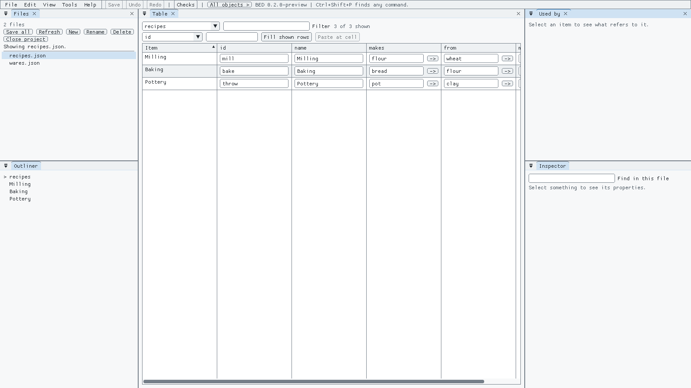
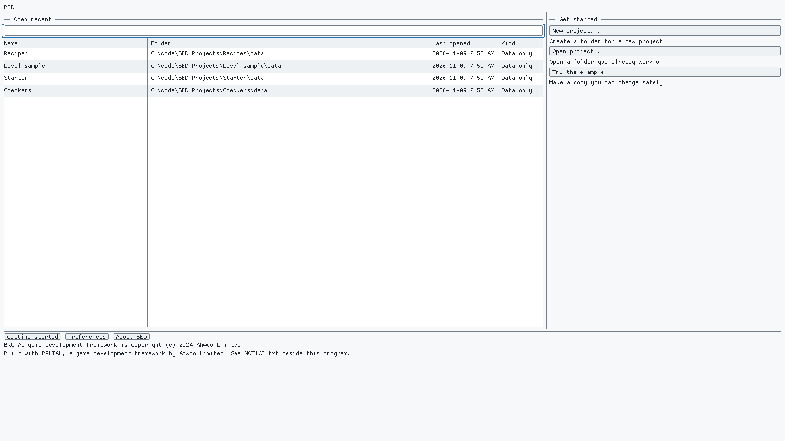
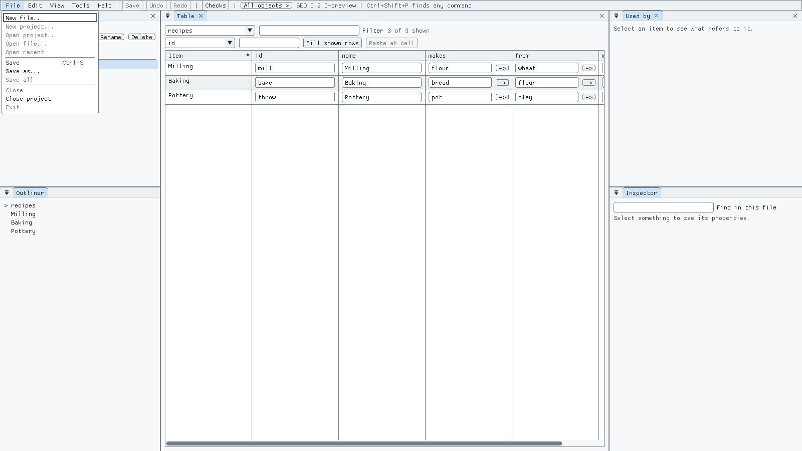
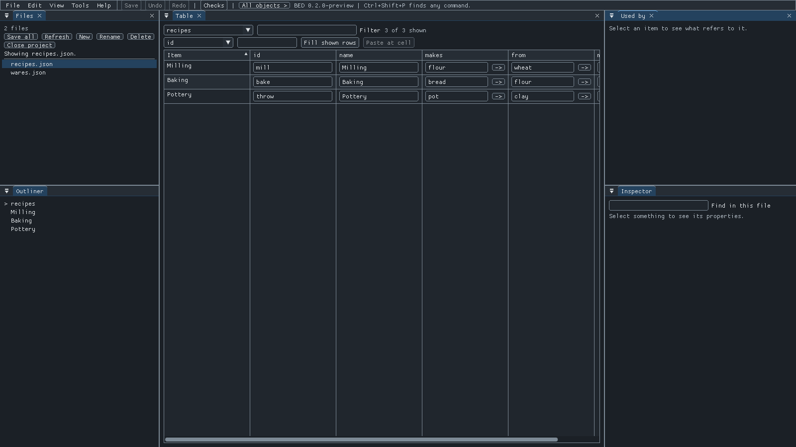
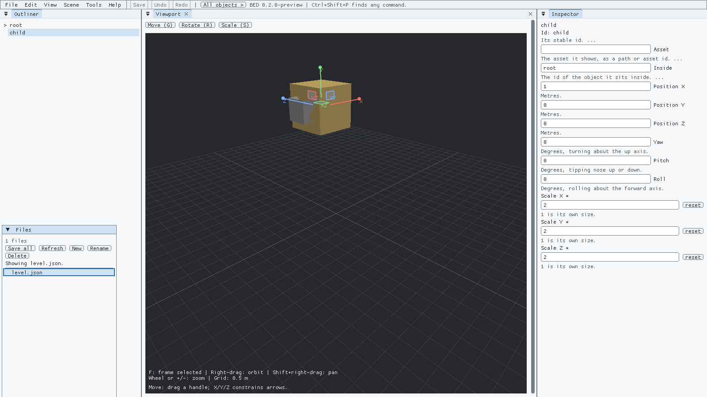
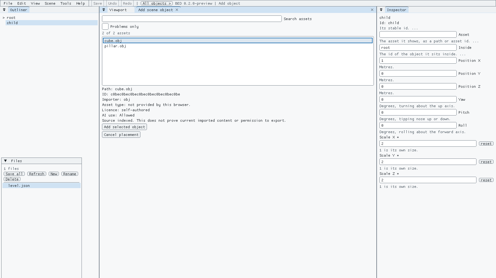

# BED: a game data editor

BED lets you and your AI assistant read, check and edit a game's JSON data through schema-checked tools. Use an MCP-compatible app or an assistant that can run commands. [Start with the AI guide](docs/guide/using_bed_with_ai.md) for a sample walkthrough, connection examples and when to approve writes.

With a project data file open in BED, choose **Help > Use with an AI assistant** for setup examples with your project's paths filled in; the start screen's **Help: Use with an AI assistant** button shows examples for the bundled sample.

BED edits the data your game reads: lists of items, enemies, recipes, levels and settings, kept as JSON files. Every edit is checked as you make it, so a typo or an impossible value is caught before it's saved, not when the game crashes.

It's made for games written in C# on the [BRUTAL framework](https://github.com/ahwootech/BRUTAL), but it works on any folder of JSON files.



## Try it (Windows, 2 minutes)

1. Download **BED-win-x64.zip** from the [Releases page](../../releases). It is a 0.2 preview: the data editor is complete, and the 3D level tools are still being finished (see the [roadmap](ROADMAP.md)).
2. Unzip it anywhere and double-click **BED.exe**. BED needs the Microsoft Visual C++ Redistributable (x64). If it is missing, install it from [Microsoft](https://aka.ms/vs/17/release/vc_redist.x64.exe), then open BED again.
3. Click **Try the example**.
4. Click a cell in the table, type a new value and press Enter.
5. Now type **-5** in the "minutes" column. BED refuses it and says why.
6. Press **Ctrl+Z** to undo and **Ctrl+S** to save.

The zip also has a small checkers game made with BED. `START_HERE.txt` in the zip covers both.

## Use it on your own data

On the start screen, under **Open a project**, choose:

- **Data folder:** your JSON files.
- **Schema folder:** a [JSON Schema](https://json-schema.org/) for each file. `wares.json` is checked by `wares.schema.json`.

Then click **Open**. If a file doesn't match its schema, BED still opens it and helps you fix it one edit at a time. It won't save over a file that another program changed after you opened it.

## What it does

- **Tables and forms** for your data, with undo and redo for every change.
- **Links between files.** Click a name to jump to the item it refers to, and see everything that refers to an item.
- **Your game's own rules.** A small C# adapter adds checks, panels or a playable preview for your game. See [Writing an adapter](docs/guide/writing_an_adapter.md).
- **A command line** (`bed-cli.exe`) that makes the same checked edits, for scripts, AI assistants and screen readers.
- **Keyboard and screen-reader friendly.** See [Using a screen reader](docs/guide/using_a_screen_reader.md).

## What BED looks like

BED opens a game's data folder and shows each file as a table you can sort, filter and fill. Pick a row to edit it in the inspector, follow a link to the item it points at, and undo anything. With a game's adapter loaded, BED also checks every edit against that game's own rules and can start the game with your changes in it.

| | |
|---|---|
|  |  |
| The start window: open a recent project, start a new one, or try the example. | Standard Windows menus, with Alt keys and shortcuts. |
|  |  |
| The recipes sample in the dark theme: a table of linked items, where the arrows jump to the ware each recipe uses. BED follows your Windows light or dark setting. | Editing a level: pick an object in the list or the 3D view, then move, rotate or scale it with the handles or the keyboard. |
|  |  |
| Adding a model to a level: pick it from the project's assets, see where it came from and its licence, then place it. | The checkers sample: an adapter adds a board you edit by clicking, and a Play button. |

## Made with BED

I'm using BED on three or four games of my own at the moment, each a different kind of game with its own adapter. They're why BED exists, and they keep shaping what it needs to do next.

| | |
|---|---|
|  |  |
| A card game's table. | BED on the card game's settings, with a Play button for each game. |
|  |  |
| A space sim, docked at a station. | BED on the space sim's ship augments. |
|  | |
| BED on another game's catalogue of objects. | |

## Roadmap

BED's first release, 0.2, adds 3D levels, assets, Play and Windows builds to the data editor. 2D and prefabs come next. See [the roadmap](ROADMAP.md) for what's done and what's left.

## Build from source

You need Windows and the [.NET 10 SDK](https://dotnet.microsoft.com/download).

```
git clone https://github.com/Tylermcca/BED.git
cd BED
dotnet run --project src/Brutal.Authoring.Launcher
```

To make the same zip as the Releases page: `python tools/package_release.py`. It goes in `dist/`.

## Made with AI help

BED was written with the help of Claude Code and Codex. There's no AI inside the app, and it sends nothing anywhere.

## Licence

MIT, see [LICENSE.txt](LICENSE.txt). BRUTAL has its own licence; the notices for everything BRUTAL and BED use are in [THIRD-PARTY-NOTICES.md](THIRD-PARTY-NOTICES.md).

Contributions are welcome. See [CONTRIBUTING.md](CONTRIBUTING.md).

See [CHANGELOG.md](CHANGELOG.md) for release notes and unreleased changes.
