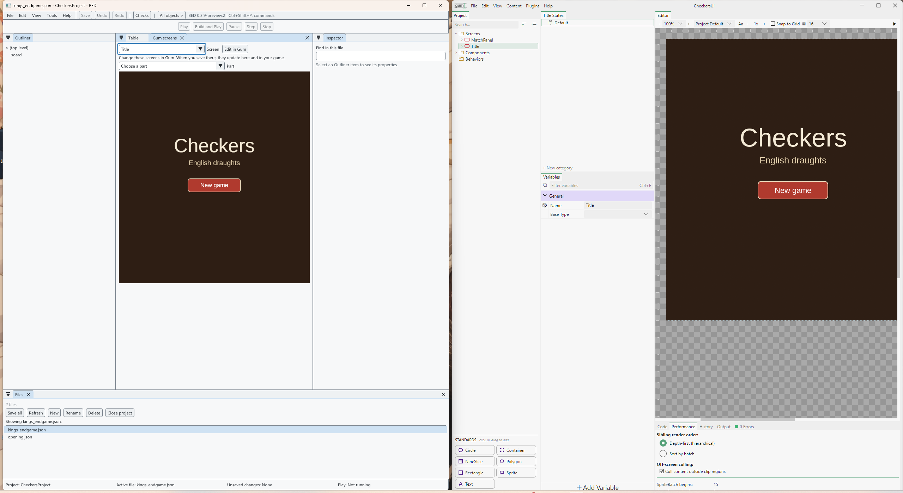
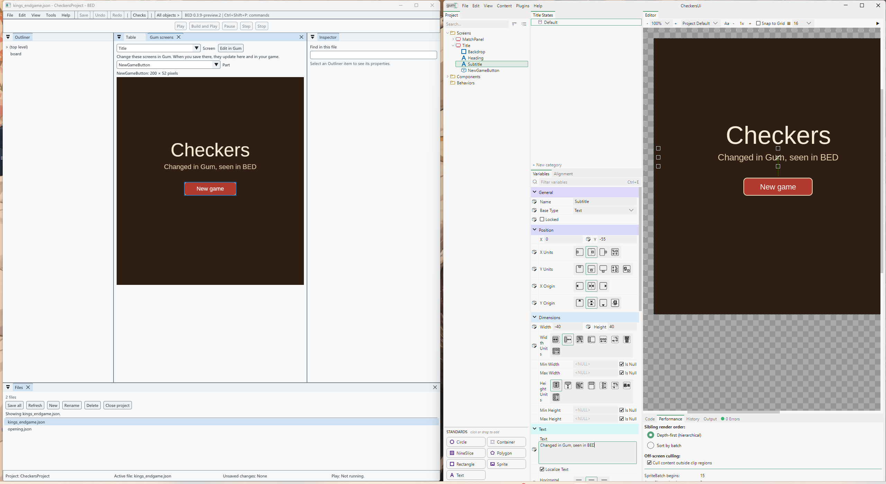

# BED: a game editor for BRUTAL games

[](https://github.com/Tylermcca/BED/actions/workflows/tests.yml)

BED edits a game's data, its 2D and 3D levels and its Gum screens, checks every change, plays the game and exports a copy, by hand or with your own AI assistant. It's free and open source (MIT).

It's made for games written in C# on the [BRUTAL framework](https://github.com/ahwootech/BRUTAL), but the data editor works on any folder of JSON files.

**[Download BED 0.4.0](../../releases/latest)** (Windows) · **[Start here](docs/guide/start_here.md)** (ten minutes, no programming) · **[What's changed](CHANGELOG.md)**



## New in 0.4: game screens made in Gum

[Gum](https://docs.flatredball.com/gum) is a free designer for game menus and screens. BED now works alongside it:

- **See your game's screens in BED,** drawn as your game will draw them (**File > Show Gum screens**).
- **Edit in Gum** opens the screen you're looking at in Gum.
- **Save in Gum, and BED updates by itself,** and so does your game if it's running. No restart, no export step.
- **Pick a part** of a screen by clicking it, or from a list for the keyboard and screen readers.
- **A Gum screens check** lists anything a screen needs and is missing, such as a picture or a font.
- **Names for copies:** choose how duplicates are named in **Options** (formerly Preferences): `Cube (1)`, `Cube.001`, `Cube_1`, `Cube2` or `Cube copy`.



**Please try to break it.** Tell us what goes wrong with **Help > Report a problem**, which shows exactly what a report contains before you share it. See [Gum screens](docs/guide/gum.md) for the details.

## Try it (Windows, 2 minutes)

1. Download **BED-win-x64.zip** from the [Releases page](../../releases/latest).
2. Unzip it anywhere and double-click **BED.exe**. BED needs the Microsoft Visual C++ Redistributable (x64); if it's missing, install it from [Microsoft](https://aka.ms/vs/17/release/vc_redist.x64.exe) and open BED again.

   Windows may show a blue "Windows protected your PC" box naming an unknown publisher, because BED isn't signed by a paid certificate yet. Click **More info**, then **Run anyway**. It only asks once for each download.
3. Click **Try the example**, and take the short tour or skip it.
4. Click a cell in the table, type a new value and press Enter. Then type **-5** in the "minutes" column: BED refuses it and shows why.
5. **Ctrl+Z** undoes, **Ctrl+S** saves.

### The samples

The start screen lists the samples that come in the download. Double-click one to open it, then choose **Tools > Build and Play** to play it.

- **A 2D garden** (`sprite-2d`): walk with the arrow keys or A and D, jump with Space, collect the coins and reach the flag.
- **A 3D island** (`prefab-physics`): a stack of crates with physics. Left-click to drop more crates; right-drag or A and D turn the camera.
- **A checkers game** (`checkers`): an adapter at work, with its title and match screens made in Gum.
- **A 3D level to build on** (`scene-starter`): add models, move them, play it and export a copy.

Move things in BED, save, play again, and the game changes with them. [Start here](docs/guide/start_here.md#5-try-the-2d-and-physics-samples) walks through them.

## What BED does

- **Game screens made in Gum:** see them, open them in Gum, check nothing they need is missing.
- **Levels in 2D and 3D:** place models or sprites, move, rotate and resize them, group them, and undo anything. The camera works like other game editors.
- **Prefabs:** make a reusable piece, place it many times, and change one copy without touching the others.
- **Physics:** bodies with mass, friction and a shape, and the level's gravity. The game simulates them when it runs.
- **Assets:** browse models, preview textures and play sounds, each with a record of where it came from and its licence.
- **Tables and forms** for your data, with errors shown next to the field, and links between files you can click through.
- **Play and Export:** run the game from your saved files, pause and step it, and export a copy that runs without BED.
- **Your game's own rules:** a small C# adapter adds checks, panels or a playable preview. See [Writing an adapter](docs/guide/writing_an_adapter.md).
- **Works with your AI assistant:** a command line (`bed-cli.exe`) and an AI connection make the same checked edits you make by hand. BED has no AI inside and sends nothing anywhere.
- **Keyboard and accessibility:** text follows Windows' text size, with larger sizes and high contrast in Options. See the [keyboard guide](docs/guide/keyboard.md) and [accessibility](docs/guide/accessibility.md).

### Use it on your own data

On the start screen, under **Open a project**, choose a **Data folder** (your JSON files) and a **Rules folder** (one [JSON Schema](https://json-schema.org/) per data file: `wares.json` is checked by `wares.schema.json`), then click **Open**. If a file breaks its rules, BED still opens it and helps you fix it, and it won't save over a file another program changed.

The [guide index](docs/guide/README.md) covers everyday editing, [levels](docs/guide/levels.md), [Play](docs/guide/playing.md), [Export](docs/guide/exporting.md), [troubleshooting](docs/guide/troubleshooting.md) and [working with an AI assistant](docs/guide/using_bed_with_ai.md).

## What BED looks like

| | |
|---|---|
|  |  |
| A 2D level with sprites. | A 3D level with prefabs and physics. |
|  |  |
| A data table in the dark theme. | A board game's adapter: edit the board by clicking. |

## Made with BED

I'm using BED on three or four games of my own, each a different kind of game with its own adapter. They're why BED exists, and they keep shaping what it does next.

| | |
|---|---|
|  |  |
| A card game's table. | BED on the card game's settings. |
|  |  |
| A space sim, docked at a station. | BED on the space sim's ship augments. |

## What's next

0.4.x releases fix what people find. Then 0.5 works with the running game (see and try values while it runs, open its code with build errors in plain words) and makes BED work well with the AI app you already use. See [the roadmap](ROADMAP.md).

## Build from source

You need Windows and the [.NET 10 SDK](https://dotnet.microsoft.com/download).

```
git clone https://github.com/Tylermcca/BED.git
cd BED
dotnet run --project src/Bed.Launcher
```

The samples are in the `samples` folder: the level sample is `samples/SceneStarterProject`. To package your build as a Windows zip: `python tools/package_release.py`. It goes in `dist/`.

## Made with AI help

BED was written with the help of Claude Code and Codex. There's no AI inside the app, and it sends nothing anywhere.

## Licence

MIT, see [LICENSE.txt](LICENSE.txt). BRUTAL has its own licence; the notices for everything BRUTAL and BED use are in [THIRD-PARTY-NOTICES.md](THIRD-PARTY-NOTICES.md). Contributions are welcome: see [CONTRIBUTING.md](CONTRIBUTING.md).
