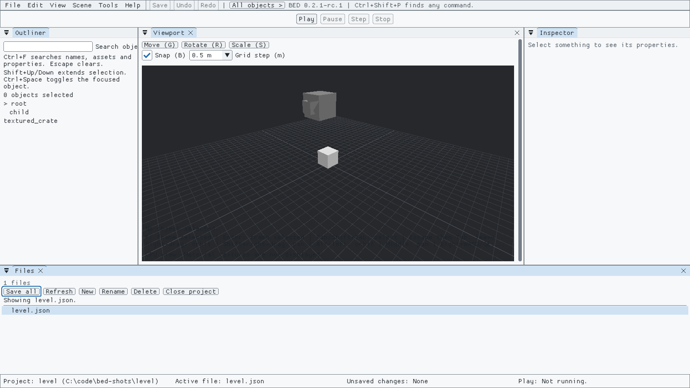

# Edit a level

A level contains objects you can move, rotate, resize and group. A game's adapter connects its level files to BED's level editor. Stop Play before changing the level.

For newer levels with prefabs, sprites or physics, see [Reusable pieces](prefabs.md) and [Flat levels](flat_levels.md). Their controls differ a little from the steps below.

## Quick steps

1. Choose **File > Open project...** and open your project folder (to try it, use **samples/scene-starter** from the download).
2. If the level isn't showing, click **level.json** in **Files** at the bottom.
3. Click an object in the **Viewport**, or its name in the **Outliner** on the left. The **Inspector** on the right shows its position, rotation and scale.
4. Press **G**, **R** or **S** (or click **Move**, **Rotate** or **Scale**) and drag a handle. You can also type exact numbers in the Inspector.
5. To look around: **Alt** + left drag orbits, middle drag pans, **Alt** + right drag zooms, and **F** frames the selection. Hold the right button and press **W**, **A**, **S**, **D**, **Q** or **E** to fly.
6. Press **Ctrl+Z** to undo a step, and **Ctrl+S** to save.

The sections below explain each part in detail.

## Open and select objects

Choose **Open project** and select your project folder. A level project opens straight into its level; to open another level, choose it in **Files**. For the 3D example, choose the supplied level-example folder. The project must include its level schema and adapter connection.

The **Outliner** window contains the object list. Select a row, or click an object in the 3D view, to inspect it. Ctrl-click a row to toggle it in the selection. On scene rows, **Shift+Up/Down** extends the keyboard selection and **Ctrl+Space** toggles the focused object. Use Ctrl+Tab to choose a panel, Tab to reach its rows, and the arrows to navigate. **F** focuses the selected outline branch; **Escape** steps out of that focus. The Inspector follows the selected object.

With the Outliner focused, **Ctrl+F** enters **Search objects**. Search by object ID or name, asset name, or property name or value. Parents of matching objects remain visible, so you can follow the hierarchy. **Escape** clears the filter. Searching changes the view and leaves the saved level alone.

## Add an object

With the level open:

1. Clear the selection to place an object on its own, or select an object to add to its group.
2. Choose **Scene > Add object**, or press **Insert** outside a text field.
3. Search the asset picker and select an asset.
4. Choose **Add selected object**. Use **Cancel placement** to leave the scene unchanged.

An object added to a group starts at the selected object's position. An object placed on its own starts at the view centre. You can also drag a model from Assets into the level. **Ctrl+Z** undoes either kind of addition.

If placement refuses, read its reason and start Add object again after fixing it. **No asset catalog for this project** means the asset setup is missing; check the project's instructions.

## Move, rotate and scale

Use **Position**, **Rotation** and **Scale** in the Inspector, or focus the 3D canvas and use its toolbar and handles. A child's Inspector position is relative to its parent.

| Canvas control | Action |
| --- | --- |
| **Move (G)** / **G** | Choose translation. Arrows nudge along the ground directions nearest the camera. |
| **Rotate (R)** / **R** | Choose rotation; choose **X**, **Y** or **Z** before turning with arrows. |
| **Scale (S)** / **S** | Choose scale. Arrows change uniform scale until you choose X, Y or Z for a local axis. |
| **X**, **Y**, **Z** | Constrain the current tool to an axis. |
| **F** | Frame the selected object's bounds. |
| **Escape** | Cancel an active transform gesture. |

Each accepted keyboard nudge is one undo step. Without move snapping, an ordinary ground-direction arrow nudge is 0.5 metre. With no selection, or with Ctrl held, arrows orbit instead of moving an object.

To move the camera:

| Mouse and keys | Camera |
| --- | --- |
| **Alt** + left drag, or right drag | Orbit. |
| Middle drag, or **Shift** + right drag | Pan. |
| **Alt** + right drag | Dolly in and out. |
| Hold the right button, then **W**, **A**, **S**, **D** | Fly forward, left, back and right. **Q** goes down and **E** up; **Shift** flies faster. |
| Wheel, or **+** / **-** | Zoom. |
| **F** | Frame the selection. |

Camera moves never change the level. If you prefer **W**, **E** and **R** for Move, Rotate and Scale, choose **Edit > Preferences > Open preferences...** (Ctrl+,) and set **Viewport keymap** to **W/E/R**.

**Snap (B)** toggles move and rotation snapping; press **B** while the canvas has focus for the same action. **Grid step (m)** offers 0.1, 0.25, 0.5 and 1 metre. Snapped arrow moves use the selected grid step. Rotation snaps to 15 degrees while Snap is on. Hold **Shift** while dragging to reverse snapping for that drag, or hold **Alt** to reverse it for arrow-key nudges.

## Duplicate, copy and paste

These shortcuts are defaults. F1 opens Keys with the bindings currently in effect. Use them outside a text field.

| Shortcut | Edit menu command | Result |
| --- | --- | --- |
| **Ctrl+D** | **Duplicate** | Copy the selected objects to new unique IDs, move the copies 1 metre along world X and select them. |
| **Ctrl+C** | **Copy** | Remember the selected objects in this project's in-app clipboard. |
| **Ctrl+V** | **Paste** | Paste those objects with new unique IDs, move them 1 metre along world X and select them. |

Duplicate and Paste each make one undo step. Copy leaves the level unchanged. To paste into another level in the same project, copy first, open the other level in Files, then paste. Opening another project clears this clipboard.

Links between copied objects follow their copies. A link to an object outside the copied selection must resolve in the destination level; copy that target too if the refusal names it. If a copied object's parent is absent from the destination, Paste detaches that object while preserving its world pose. Include children in the copied selection when you want them copied too.

## Group and ungroup

**Ctrl+G**, or **Edit > Group**, puts the selected objects under a new empty parent at their world-position centre. It preserves their world poses and selects the new parent. The parent receives a unique ID such as group or group_2.

Select one parent and use **Ctrl+Shift+G**, or **Edit > Ungroup**, to remove it and select its children. Child world transforms stay unchanged. Group and Ungroup each make one undo step.

Step out of outline focus before grouping. Ungroup refuses when another object has a named reference to the parent. Use Delete to review and clear those references first if removing that parent is intended.

## Rename an ID

Select one object and press **F2**, or choose **Edit > Rename object**. Type the new **Object ID** in the inline field. **Enter** commits; **Escape** cancels.

An ID starts with a lowercase letter and contains only lowercase letters, digits and underscores. An empty, invalid or already-used ID refuses with a reason; correct the field and try again. Renaming updates parent links and named references to that object, keeps the object order and makes one undo step. It changes the ID, which can differ from a separately supplied display name.

## Delete and review references

Select one object and press **Delete**, or choose **Edit > Delete**. If other objects refer to it, **Delete referenced object?** lists those objects and their links.

Choose **Cancel** (or Escape) to keep everything. **Delete anyway** removes the selected object, keeps the other objects, detaches its children at their world positions and clears their links to the removed ID. Undo restores the object and its links together. A delete without referring objects happens immediately.

## Save and undo

**Ctrl+Z** undoes a document edit; **Ctrl+Y** redoes it. **Ctrl+S** saves the active level through its validation, save policy and file-conflict checks.

If another program changed or removed the saved file, BED keeps your draft and asks you to resolve the conflict. Stop Play before saving. Use **Save** for a level. **Save as** is unavailable for levels and says why: a level keeps its place in the project. Play and export use saved files and retain the undo history.

**Save all** and **Close project** handle levels and data files together. Closing the 3D view's tab or window, or the level with **Ctrl+W** or **Ctrl+F4**, asks **Save**, **Don't Save** or **Cancel** if the level has unsaved changes.

Next: [browse assets](assets.md), [run Play](playing.md), [export a build](exporting.md), or [see all keyboard controls](keyboard.md).
