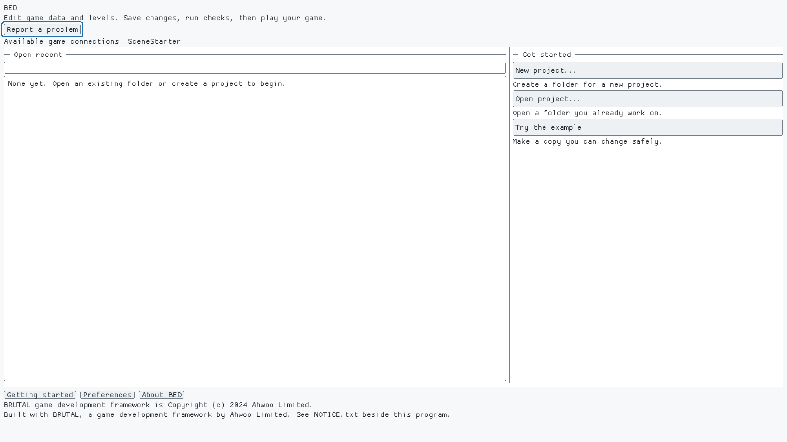
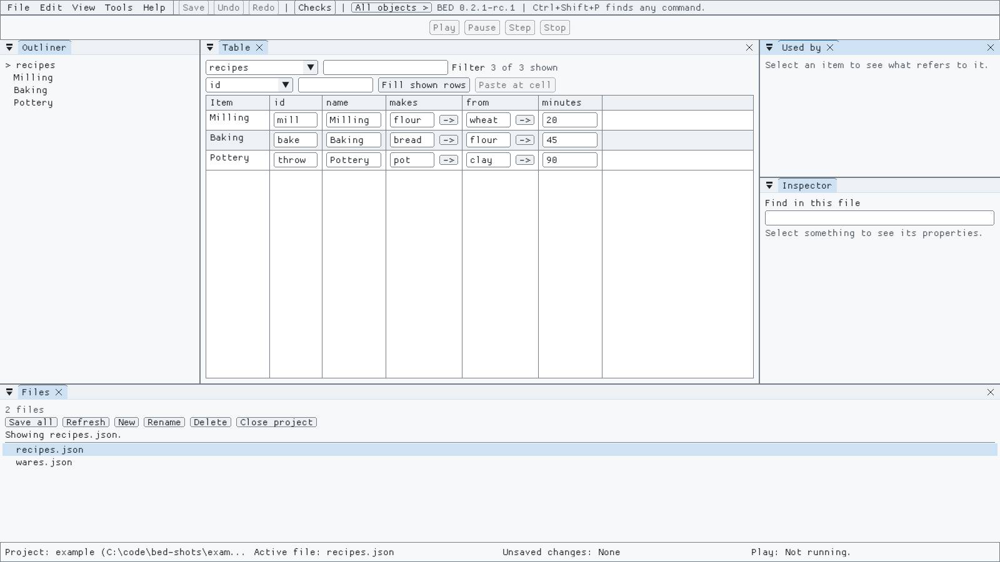
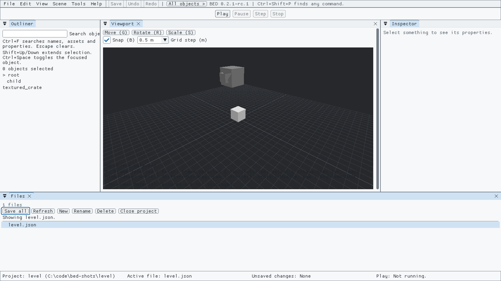

# Start here

**Goal:** in about ten minutes, change some game data, move an object in a 3D level, play the level and save your work.

**What you need:** Windows 10 or 11 and the BED download (a zip file). You don't need a terminal, a code editor or any programming.

## 1. Open BED

1. Unzip the download into a folder you can write to, such as your Documents folder.
2. Double-click **BED.exe**.
3. If Windows shows a blue "Windows protected your PC" box that names an unknown publisher, click **More info**, then **Run anyway**. Windows shows it because BED isn't signed by a paid certificate yet. It only asks once for each download.

BED opens on its start screen. The first time you open a project, BED offers a short guided tour. You can take it now, or skip it and reopen it later from **Help > Take the tour**. This page covers the same ground in more detail.

If Windows says **VCRUNTIME140.dll** is missing, install Microsoft's Visual C++ Redistributable (x64) from <https://aka.ms/vs/17/release/vc_redist.x64.exe> and try again. Most PCs already have it.

## 2. Change some data

1. On the start screen, click **Try the example**. BED copies a small example project for you and opens it, so you can change it freely.
2. The middle of the window is a **Table**. Each row is one recipe: Milling, Baking and Pottery.

   

3. Click the **minutes** box for Baking, type **50** and press **Enter**. The value changes, and the status bar at the bottom says **Unsaved changes: 1 file**.
4. Now try a mistake. Click the same box, type **-5** and press **Enter**. BED refuses it and shows why next to the field. The saved value doesn't change.
5. Press **Ctrl+Z** to undo and **Ctrl+Y** to redo.
6. Click the **->** button beside **flour** in the **makes** column. BED opens wares.json at the ware that recipe makes. Click **Back** above the table to return.
7. Press **Ctrl+S** to save.

## 3. Move an object in a level

1. On the start screen, under **Samples**, click **3D level to build on**. (From an open project, choose **File > Open project...**, go to the folder you unzipped, open **samples**, choose **scene-starter** and click **Open**.)
2. BED opens the level. You'll see the **Outliner** on the left (every object in the level), the 3D **Viewport** in the middle and the **Inspector** on the right.

   

3. Click the white box in the viewport. Its name highlights in the Outliner, and the Inspector shows its position, rotation and scale.
4. Press **G** (or click **Move (G)**) and drag one of the coloured arrows to move the box. With **Snap (B)** ticked, it moves in 0.5 m steps.
5. To look around: hold **Alt** and drag with the left mouse button to orbit, drag with the middle button to pan, and hold **Alt** and drag with the right button to zoom. Hold the right button and use **W A S D** (and **Q E**) to fly. Press **F** to frame the selected object.
6. Press **Ctrl+Z** if you want the box back where it was, then **Ctrl+S** to save.

## 4. Play the level

1. Click **Play** in the middle of the toolbar.
2. If BED says the game needs building, choose **Tools > Build and Play** instead. BED builds the level and starts the game.
3. The game runs in its own window, using your saved files. Click **Stop** (or close the game window) to finish.

Play always uses what you saved, so save before you press Play.

## 5. Try the 2D and physics samples

The download has two more samples in its **samples** folder. They show what 0.3 adds: reusable pieces (prefabs), flat 2D levels made of pictures (sprites), and physics. Each one is a small game you play in its own window.

### A flat sprite level

1. On the start screen, click **2D garden game** under **Samples** (or choose **File > Open project...**, open **samples**, choose **sprite-2d** and click **Open**). The level opens in the flat **Flat XY** view instead of the 3D one.
2. The level is a small cartoon garden of seventeen pictures in four layers: sky, hills, ground, crates, coins, flowers, flags and a round friend. A flag on a block is a reusable piece placed twice.
3. Click the round friend in the Outliner and drag it in the view. Press **Ctrl+Z** to put it back.
4. Click the right-hand flag. Its size has been changed on this copy only, so the Inspector marks that field and shows a **Revert** button. Revert makes it match the left flag; **Ctrl+Z** brings the change back.
5. Press **Ctrl+S** to save, then choose **Tools > Build and Play**. If BED shows a build command and asks to allow it, allow it. The game opens in its own window with the level exactly as you saved it.
6. Play: the round friend moves with the **arrow keys** or **A** and **D**, and jumps with **Space**, **Up** or **W**. Collect every coin (the count is in the top corner), then reach a flag to see "You did it!". **R** starts again; **Esc**, closing the window or **Stop** ends the game.
7. Move a crate or a coin in BED, save, and play again: the game uses your new layout. The ground and crates (the drawing layer at order 0) are solid; coins are things named `coin...`, and flags are things with `flag` in their name.

### Prefabs with physics

1. On the start screen, click **3D crate island** under **Samples** (or choose **File > Open project...**, open **samples**, choose **prefab-physics** and click **Open**). The 3D level opens.
2. You'll see a grassy island, a red and white paddle and a stack of three crates. The crates are one reusable piece placed three times. The floor doesn't move, the crates fall under gravity, and the game slides the paddle from side to side.
3. Click a crate. The Inspector shows its body: how it moves, its mass, its friction and its shape. The top crate weighs more than the others; its mass is marked as changed on that copy only.
4. Choose **View > Physics** to see the level's gravity and time step.
5. Choose **Tools > Build and Play**, and allow the build command if BED asks. A game window opens on the island: the stack settles, the paddle slides from side to side and pushes whatever is in its way.
6. Play with it. Left-click the island to drop another crate there (a click off the island drops one in the middle). Hold the right mouse button and drag, or press **A** and **D**, to turn the camera; scroll to zoom. Press **R** to put everything back as saved and **Esc** to close the game. When it closes, **Play console** shows a short summary: how many bodies and steps it ran, where the top crate came to rest and how far the paddle travelled.
7. Close the game, move a crate or the paddle in the 3D view, save and press **Build and Play** again. The game starts from your saved level.

Your saved level never changes when the game runs. Both samples can also be copied as a standalone game with **File > Export build**; see [Export a game build](exporting.md).

## 6. Close up

1. Choose **File > Close project**. If anything is unsaved, BED asks whether to **Save**, **Don't Save** or **Cancel**.
2. Next time, your projects are listed under **Open recent** on the start screen.

## If it doesn't look like this

- **Some panels are missing:** choose **View** and turn the panel back on, or choose **View > Reset layout**.
- **The text is too small or too large:** BED follows Windows' text size. You can also choose **View > Larger text** or **View > Smaller text**, or **Edit > Preferences > UI scale**.
- **A message says something can't be saved:** read the message next to the field. It says what to change. Your draft is kept until you fix it or undo it.
- **Something else went wrong:** choose **Help > Report a problem**. BED shows you exactly what the report contains before anything leaves your PC.

## Next steps

- [Edit project data](data_workflow.md): tables, forms, links between files and changing many rows at once.
- [Edit a level](levels.md): add models, group objects and change transforms.
- [Reusable pieces](prefabs.md) and [Flat levels](flat_levels.md): prefabs and 2D sprite levels.
- [Play](playing.md) and [Export a game build](exporting.md): run your game and make a copy you can share.
- [Use BED with an AI assistant](using_bed_with_ai.md).
- Building an editor for your own game's data? See the [developer walkthrough](developer_walkthrough.md).
